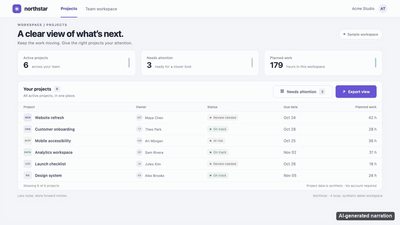

# browser-demo-videos

**Ask your coding agent for a browser demo. Get a real MP4, not simulated UI.**

This skill records native browser clicks, typing, and navigation with readable captions, target spotlights, a visible cursor, and optional synthetic narration. It keeps scene screenshots, timing, and a manifest so you can review the result before sharing it.

## Install once, then ask

You need a command-capable coding agent that supports skills, **Node.js 24+ with npm**, and **Git** before installing. Run this in the project where you use your agent:

```sh
npx skills add santychuy/browser-demo-videos
```

Select your agent in the installer. If it does not discover the new skill immediately, reload its skills or start a new agent session.

**Try the bundled sample — no app URL, API key, or repository checkout needed:**

> Use browser-demo-videos to make the bundled sample demo.

The skill bundles its CLI and sample app. Your agent prepares browser and media tooling within your permissions—no clone or separate CLI installation. System-package changes may require approval.

## See the result

[](https://github.com/santychuy/browser-demo-videos/releases/download/v0.1.0/demo.mp4)

[Download the narrated MP4](https://github.com/santychuy/browser-demo-videos/releases/download/v0.1.0/demo.mp4). This example uses **synthesized OpenAI GPT-Live narration** (`gpt-live-1`), not a human voice or the separate OpenAI Chat provider. The GIF is a silent, accelerated preview; follow the full MP4 link for audio and original pacing. The default sample you generate is caption-only and makes no paid request.

The bundled Northstar app uses synthetic project data. Its walkthrough shows the project list, applies an attention filter, proves the narrowed result, and navigates to the export summary. The `demo` command starts and stops its own loopback-only server.

**Then try your own app** (replace the URL and feature):

> Use browser-demo-videos to demo the filter and export flow at https://my-app.example.

## What to expect

First use checks the pinned browser tooling, Chromium, and FFmpeg/ffprobe, and downloads missing dependencies when permitted. Node.js and Git must already be available for the initial installation command.

- **Actual interactions:** one explicit `agent-browser` session operates the page. No application-source changes or fabricated results.
- **Reviewable output:** final and raw MP4s, scene screenshots, timeline, and complete-run manifest. The agent retains the input plan and reports observed review, not just command success.
- **macOS and Linux:** captions work without a voice key. Local speech uses macOS `say` only; Linux has no bundled offline speech engine. Other operating systems are not a supported portability claim.
- **Optional speech:** macOS system speech, OpenAI Chat, actual OpenAI GPT-Live, xAI Grok, and the separate vendor Groq Preview. Cloud speech requires the selected provider's private key, explicit consent to send the script, and acceptance of provider charges.
- **Honest fallback:** a missing selected cloud key can fall back only to macOS `say` / Samantha. On Linux it blocks, rather than silently dropping speech. Invalid credentials or provider errors fail without automatic retries or provider switching. A local fallback never satisfies an explicit GPT-Live request.
- **Local, not redacted:** recordings and other artifacts stay local unless you share them, but can contain page data, spoken scripts, URLs, and local paths. Review before publishing. Do not paste keys into chat or record real credentials.

Recording takes time, especially on first setup or with speech generation. Timing is calibrated, not frame-perfect; a successful command or matching speech transcript does not replace watching and, for narration, listening to the video.

## Learn more

- [Usage, setup, CLI, narration, and limitations](docs/usage.md)
- [Plan format and exact action schema](skills/browser-demo-videos/references/plan-format.md)
- [Installed skill workflow](skills/browser-demo-videos/SKILL.md)
- [Architecture and safety boundaries](docs/design.md)
- [Contributing](CONTRIBUTING.md) · [Security](SECURITY.md) · [Changelog](CHANGELOG.md)

## Related projects and inspiration

- [vercel-labs/skills](https://github.com/vercel-labs/skills) distributes skills; [vercel-labs/agent-skills](https://github.com/vercel-labs/agent-skills) demonstrates skill packaging and progressive guidance, following the [Agent Skills specification](https://agentskills.io/specification).
- [vercel-labs/agent-browser](https://github.com/vercel-labs/agent-browser) is the browser controller used by this project.
- [obra/superpowers](https://github.com/obra/superpowers) is an inspiration for explicit, review-oriented agent workflows.
- [Remotion](https://github.com/remotion-dev/remotion) is a README presentation reference for showing the output early, not this project's rendering engine. That reference is not a claim of code reuse or shared licensing.

## License

MIT: see the [root license](LICENSE) and [bundled skill license](skills/browser-demo-videos/LICENSE). Upstream tools and services retain their own licenses and terms.
